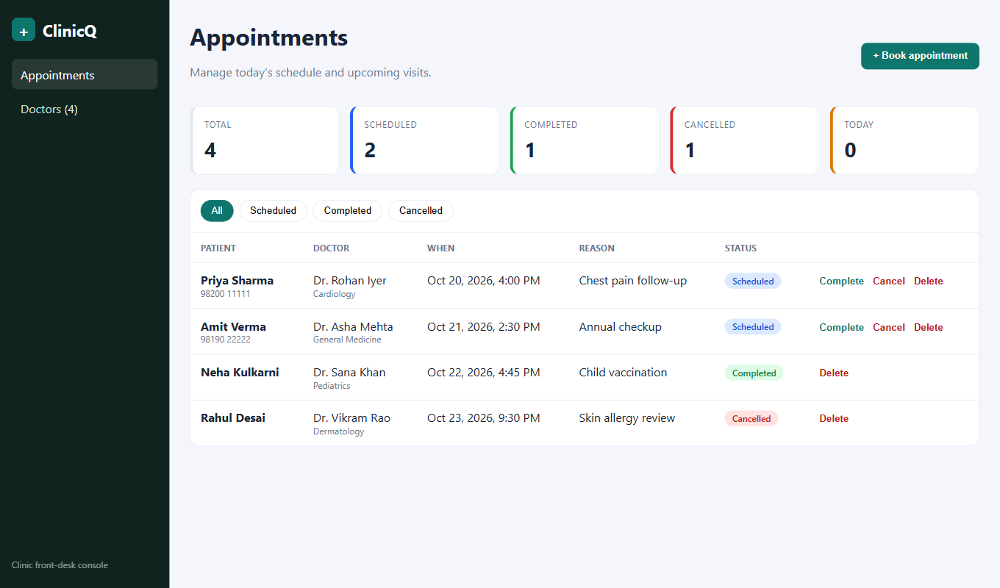
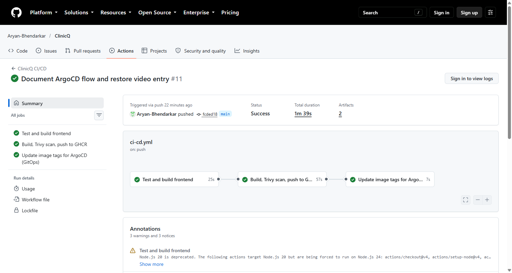
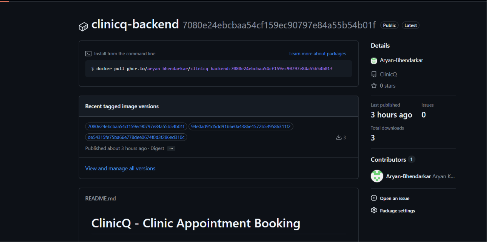
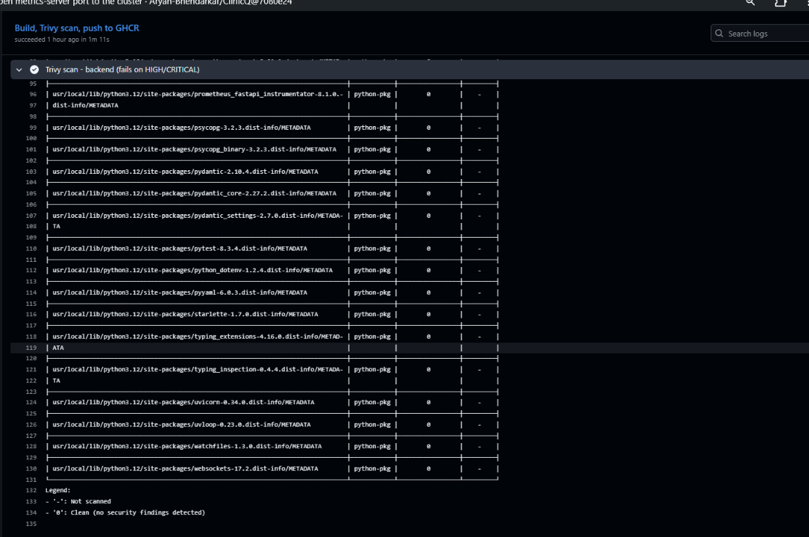
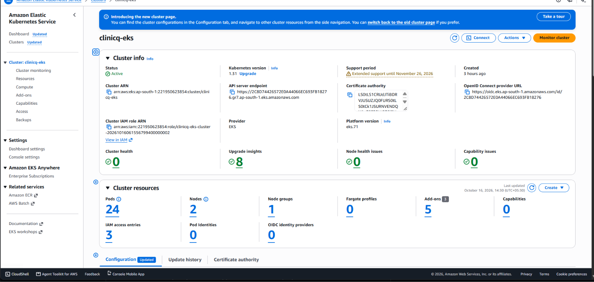
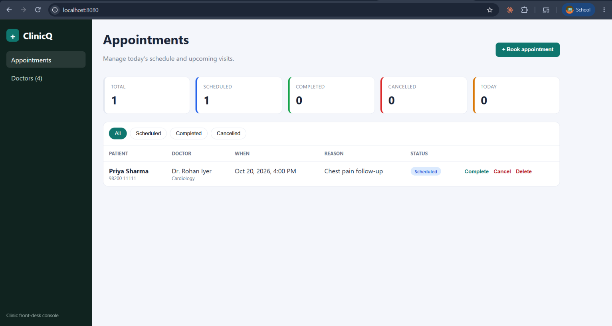
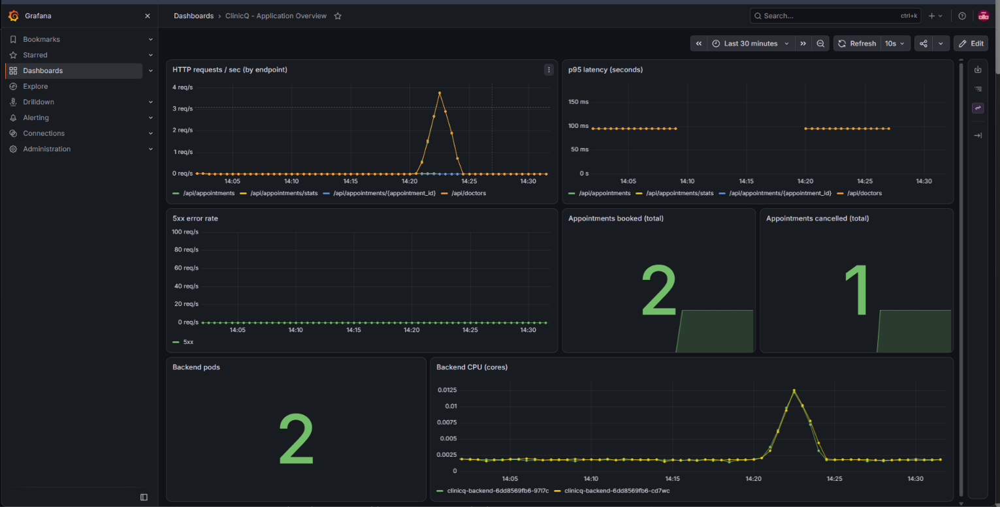

# ClinicQ - Clinic Appointment Booking

ClinicQ is a front-desk console for a medical clinic. Staff book appointments for patients with a doctor,
see the day's schedule, mark visits completed or cancelled, and the system refuses to double-book a doctor's time slot.

It is built as a DevOps capstone: the application is small on purpose, and the focus is on how it travels from
a laptop to a monitored Kubernetes cluster on AWS.



## Architecture

```text
Developer -> Git/GitHub -> GitHub Actions
                              |- pytest (gate)
                              |- frontend build
                              |- Docker build (backend + frontend)
                              |- Trivy scan (fails on HIGH/CRITICAL)
                              |- push to GHCR, tagged with the commit SHA
                              '- helm upgrade --install  ->  EKS

Terraform -> AWS VPC (2 public + 2 private subnets, NAT) -> EKS (managed node group)
                                   |
        Ingress (nginx) --/-->  frontend (React, nginx)  x2
                        --/api-> backend  (FastAPI)      x2..6 (HPA)  --> PostgreSQL (StatefulSet + EBS PVC)
                                   |
                  Prometheus (ServiceMonitor scrapes /metrics) -> Grafana dashboard
```

| Layer | Technology |
|---|---|
| Frontend | React 18 + Vite, responsive CSS, served by unprivileged Nginx |
| Backend | FastAPI, SQLAlchemy 2, Alembic, Pydantic |
| Database | PostgreSQL 16 |
| Tests | Pytest (SQLite in-memory test DB, 15 tests) |
| Containers | Docker multi-stage builds, non-root users, Docker Compose |
| CI/CD | GitHub Actions, GHCR, Trivy |
| IaC | Terraform (AWS VPC + EKS + EBS CSI + metrics-server) |
| Orchestration | Kubernetes, Helm chart, Ingress, HPA, migration Job |
| Observability | kube-prometheus-stack, ServiceMonitor, Grafana dashboard |

## REST API

| Method | Path | Purpose |
|---|---|---|
| GET | `/health`, `/ready`, `/metrics`, `/` | liveness, readiness (checks DB), Prometheus metrics |
| GET / POST | `/api/doctors` | list / add doctors |
| DELETE | `/api/doctors/{id}` | remove a doctor (409 if they have appointments) |
| GET | `/api/appointments?status=&doctor_id=` | list, filterable |
| POST | `/api/appointments` | book (409 if the slot is taken, 422 for unknown doctor) |
| GET / PUT / DELETE | `/api/appointments/{id}` | read, update (reschedule, change status), delete |
| GET | `/api/appointments/stats` | counts for the dashboard cards |

Swagger UI: `http://localhost:8000/docs`.

Custom Prometheus counters: `clinicq_appointments_booked_total`, `clinicq_appointments_cancelled_total`,
plus request count/latency metrics from the FastAPI instrumentator.

## Run locally

```bash
docker compose up --build
# UI       http://localhost:3000
# API docs http://localhost:8000/docs
docker compose down -v      # stop and delete the DB volume
```

Run the tests (no database needed):

```bash
cd backend
python -m venv .venv && source .venv/bin/activate   # Windows: .venv\Scripts\activate
pip install -r requirements.txt
pytest -v
```

## Repository layout

```text
backend/            FastAPI app, Alembic migrations, pytest tests, Dockerfile
frontend/           React app, nginx template, multi-stage Dockerfile
docker-compose.yml  full local stack (postgres + backend + frontend)
terraform/          AWS VPC + EKS
helm/clinicq/       Helm chart (deployments, services, ingress, HPA, postgres, migrate job, ServiceMonitor)
k8s/                namespace manifest
monitoring/         Prometheus/Grafana/ingress-nginx values + Grafana dashboard
troubleshooting/    three deliberately broken manifests for the live demo
scripts/            load-test.sh
.github/workflows/  CI/CD pipeline
docs/               submission runbook and evidence
```

## Deploy to AWS (summary)

```bash
cd terraform && terraform init && terraform apply          # VPC + EKS (~15 min)
aws eks update-kubeconfig --region ap-south-1 --name clinicq-eks
kubectl apply -f k8s/namespace.yaml -f k8s/storageclass.yaml   # gp3 default class for the Postgres volume
# ingress controller + monitoring
helm repo add ingress-nginx https://kubernetes.github.io/ingress-nginx
helm repo add prometheus-community https://prometheus-community.github.io/helm-charts
helm upgrade --install ingress-nginx ingress-nginx/ingress-nginx -n ingress-nginx --create-namespace -f monitoring/ingress-nginx-values.yaml
helm upgrade --install kube-prometheus-stack prometheus-community/kube-prometheus-stack -n monitoring --create-namespace -f monitoring/prometheus-values.yaml
kubectl apply -f monitoring/dashboards/clinicq-dashboard.yaml
# application (CI does this automatically on every push to main)
helm upgrade --install clinicq ./helm/clinicq -n clinicq -f helm/clinicq/values-prod.yaml \
  --set backend.image=ghcr.io/<user>/clinicq-backend --set frontend.image=ghcr.io/<user>/clinicq-frontend \
  --set backend.tag=<sha> --set frontend.tag=<sha> --set postgres.password=<secret>
terraform destroy   # when finished, to stop AWS charges
```

The full runbook, the problems hit while deploying and how they were fixed are in [docs/SUBMISSION.md](docs/SUBMISSION.md).
The presentation script is in [docs/PRESENTATION.md](docs/PRESENTATION.md).

**Known limitations**

- The AWS account used (Free Tier plan) cannot create load balancers, so the Ingress is reached with
  `kubectl port-forward` instead of a public address.
- The pipeline's `deploy` job is conditional on a `KUBE_CONFIG_DATA` secret. It is not configured, so the cluster
  was deployed with `helm upgrade --install` using the SHA-tagged images the pipeline pushed.

## Evidence

| | |
|---|---|
|  |  |
| GitHub Actions: test, build, Trivy scan, push | GHCR images tagged with the commit SHA |
|  |  |
| Trivy scan: zero findings | EKS cluster in ap-south-1 |
|  |  |
| App served through the Ingress | Grafana dashboard with live metrics |

## Design decisions

- **Migrations run as a Helm hook Job**, not in every pod, so several replicas never race to migrate the schema.
  Docker Compose, which has one backend, runs them on container start.
- **Readiness vs liveness**: `/health` only proves the process is alive; `/ready` also queries the database,
  so a pod without database access is taken out of the Service instead of being restarted.
- **Images are tagged with the commit SHA**, never `latest`, so every running pod traces back to a commit.
- **Nothing is pushed unless tests and Trivy pass**; the push step runs after the scan steps in the same job.
- **PostgreSQL runs in the cluster** (StatefulSet + EBS volume) to keep the capstone self-contained. In production
  I would use Amazon RDS for backups, patching and Multi-AZ failover.
- **Secrets**: the database password is a Kubernetes Secret fed from a GitHub Actions secret. No credentials are in Git.
